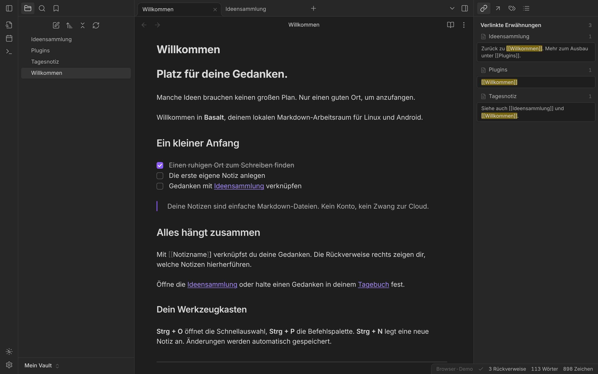
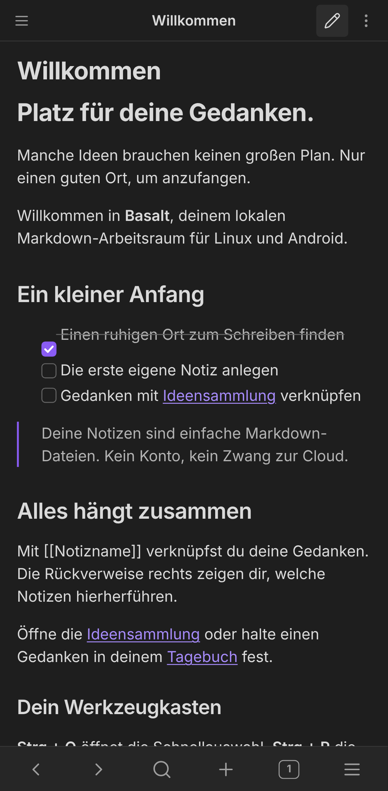
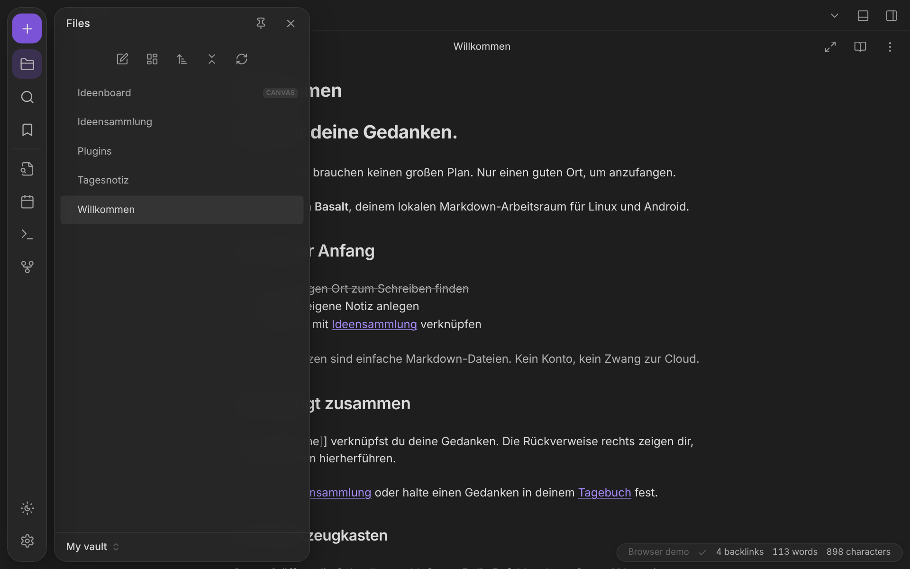

<div align="center">


# Basalt

**A quiet place for connected thoughts.**

A local-first Markdown workspace for Linux and Android, with a Rust core and support for
Obsidian vaults and selected Obsidian plugins.

[](LICENSE)


[Website](https://nino4you.github.io/basalt/) · [Live demo](https://nino4you.github.io/basalt/demo/) ·
[Features](#features) · [Installation](#installation) · [Plugins](#plugins) ·
[Building from source](#building-from-source) · [Contributing](#contributing)



</div>

## Why Basalt?

- **Your files stay your files.** Notes are plain Markdown files in a folder you choose. No
  account, no cloud, no telemetry.
- **Works with your vault.** Wiki links, tags, frontmatter, callouts, embeds and canvas files
  behave as you expect; existing Obsidian vaults open directly.
- **Built for Linux and Android.** One shared Rust core, one native Tauri app for both
  platforms, and an interface that adapts to mouse, keyboard, touch and pen.
- **Careful with your data.** Content is backed up before it is overwritten (while you type,
  every few minutes), external edits are detected instead of overwritten, and file access is
  confined to the vault.

## Features

**Writing**

- CodeMirror 6 editor with live preview: Markdown syntax fades away, links and checkboxes are
  clickable, and KaTeX math, Mermaid diagrams, tables, images and embedded notes render right
  in the editor. Tables are edited cell by cell while the Markdown stays the source of truth.
- Completion for `[[wiki links]]` (including `#headings`, `#^blocks` and note aliases) and
  `#tags`, page previews when hovering links, templates from a folder you choose (with title
  and Moment.js date placeholders), and a source mode.
- Frontmatter as editable properties (text, lists, numbers, checkboxes, dates), footnotes
  (`[^1]` and `^[inline]`), and folding of headings, lists and blocks.
- Paste or drop pictures and files into a note: they are stored in the attachment folder you
  choose and linked with `![[…]]`.
- Optional Vim key bindings (`:w` saves).
- Embeds of whole notes, a single section (`![[Note#Heading]]`) or block (`![[Note#^id]]`), and
  sized images (`![[photo.png|300]]` or `|300x200`), in live preview and reading view.
- Reading view with callouts, properties, footnotes and syntax highlighting.
- Print a note or save it as PDF (Linux), or export it as one self-contained HTML file.
- PDFs, images, audio and video open in their own tabs; PDFs are rendered locally.
- On Android, "Share" in other apps sends text, links, images and PDFs to Basalt as a new note
  or appended to the open one.

**Organizing**

- File tree with folders, bookmarks, drag & drop and safe renaming that carries open tabs,
  bookmarks and unsaved changes along; links to a renamed or moved note are updated.
- Backlinks with context, unlinked mentions that become links with one click, outgoing links,
  tags, outline and full-text search (`tag:`, `path:`, `file:`, `line:`, `section:`, `task:`,
  `task-todo:`, `task-done:`, `/regular expressions/`, exclusion with `-`) with search and
  replace across the vault.
- Daily notes with their own folder, date format (Moment.js style) and template, and commands
  to step to the previous or next one.
- Note composer: merge a note into another (properties combined, links redirected, the source
  goes to the trash) and extract a selection into a new linked note.
- Graph view for the whole vault and as a local graph of the active note, with group colors.
- Canvas in the open JSON Canvas format (`.canvas`) with text, note, link and group cards.
- Bases (`.base`): database views over note properties as tables or cards, with filters,
  formulas, sorting and grouping in the same YAML format as Obsidian Bases (see
  [docs/bases.md](docs/bases.md)).
- File recovery: every earlier version of a note or canvas and every deleted file can be
  compared with the current content and restored (command palette → "Open file recovery", or
  "Version history" in the file menu). Old backups are cleaned up after a period you choose.
- Works with folder sync tools: changes from Syncthing, Nextcloud, Dropbox or Git show up, and
  their conflict copies are found and can be compared and resolved (see
  [docs/sync.md](docs/sync.md)).

**Workspace**

- Tabs with their own history, split editors and freely dockable side views like in VS Code;
  the layout is saved per vault.
- On the desktop a note or canvas can be opened in a window of its own (tab menu → "Open in
  new window"); saves in one window show up in the other.
- Quick switcher (Ctrl+O), command palette (Ctrl+P), full keyboard navigation and hotkeys you
  can change in the settings.
- Light and dark theme with an accent color, plus Obsidian-style themes and CSS snippets from
  the vault (`Basalt/Config/themes`, `Basalt/Config/snippets`).
- A dedicated phone layout with drawers, a bottom navigation bar and a formatting toolbar.
- A tablet layout of its own: a floating dock of icons at the left edge or at the bottom
  (Settings → Appearance); sidebars float over the note as cards (no dimming, a tap beside
  one closes it) that follow the finger when dragged, and can be pinned beside the note when
  there is room; finger-sized targets and a focus mode that leaves only the note.

<p align="center">
  
</p>
<p align="center">
  
</p>

## Installation

Packages are published under [Releases](https://github.com/Nino4you/basalt/releases):

| Platform                | Package                                  |
| ----------------------- | ---------------------------------------- |
| Linux x86_64            | `.deb` or AppImage                       |
| Windows x64             | `Basalt_<version>_x64-setup.exe`         |
| Android (ARM64, x86_64) | `Basalt_<version>_android-universal.apk` |

The Linux packages need glibc 2.35 or newer and WebKitGTK 4.1, for example Ubuntu 22.04,
Debian 12, Fedora or Arch Linux. Every build is started on Debian 12, Ubuntu 24.04 (`.deb`),
Fedora and Arch Linux (AppImage) before it is released.

All downloads are signed. Please verify them against these fingerprints as described in
[docs/release-signing.md](docs/release-signing.md#verifying-downloads):

| Key                                 | Fingerprint                                                                                       |
| ----------------------------------- | ------------------------------------------------------------------------------------------------- |
| OpenPGP (Linux packages, checksums) | `628F A944 F494 AED2 1F0B  6CCD B72F F2A2 4F65 FB22`                                              |
| Android certificate (SHA-256)       | `C0:3E:FA:2F:40:12:C4:57:FC:44:D7:68:B2:64:AA:BF:0F:2D:54:D3:3B:C3:06:7B:8C:6D:1B:76:84:83:4A:51` |

To try Basalt without installing it, open the
[live demo](https://nino4you.github.io/basalt/demo/) or run it locally with
`npm ci && npm run dev` (see [Building from source](#building-from-source)). The demo only stores
data in the browser, not in real files.

## Status

Basalt is a **preview (0.4)** and not yet a complete replacement for Obsidian. The core is
stable and tested, but some things are still missing:

- no built-in sync (use a folder sync tool, see [docs/sync.md](docs/sync.md)); the desktop app and
  the Android APK install signed updates from Settings → General,
- plugin compatibility only for selected plugins (see below),
- backups of attachments have to be restored by hand (old backups are kept until you set a
  retention period in Settings → Files and links → Backups),
- not in F-Droid or Google Play yet, only direct downloads (the store listing is prepared, see
  [docs/distribution.md](docs/distribution.md)).

Make a copy of any important vault before opening it for the first time.

## Plugins

Basalt ships its own implementation of the Obsidian plugin API. Plugins live in the vault under
`Basalt/Plugins/<id>/` (`manifest.json`, `main.js`, optional `styles.css`) and only run after
you enable each one in the settings.

Settings → Community plugins installs them for you:

- **Browse** the Obsidian community catalog. Plugins Basalt has checked are marked; all others
  are untested and may work, partly work or fail visibly. Each plugin installs its latest release
  or any earlier version you pick; releases that need a newer Obsidian API are marked.
- **From GitHub** installs the latest release of any repository, such as your own plugin or a
  beta that is not in the catalog.
- **From files** installs a plugin you built yourself from its `manifest.json`, `main.js` and
  `styles.css`.
- **Check for updates** offers newer releases of installed plugins; updates keep their settings,
  and every replaced or uninstalled file is backed up in the vault.

> [!WARNING]
> Plugin code is not sandboxed and runs with the same permissions as the app. Only enable
> plugins you trust.

The goal is good support for selected plugins, not for every community plugin. Which plugins
and APIs have been checked, and where gaps remain, is listed in
[docs/plugin-compatibility.md](docs/plugin-compatibility.md). Plugins that require Node.js or
Electron APIs do not run.

## Building from source

Requirements: Node.js 22.13+ and current stable Rust. The native app additionally needs the
[Tauri system dependencies](https://v2.tauri.app/start/prerequisites/).

```sh
npm ci
npm run dev              # browser demo on http://127.0.0.1:1420
npm run tauri -- dev     # native Linux app
npm run tauri -- build   # Linux packages (.deb, AppImage)
```

Android additionally needs a JDK, the Android SDK/NDK and the Rust target
`aarch64-linux-android`:

```sh
npm run tauri -- android init --ci --skip-targets-install
node tools/patch_android.mjs
npm run tauri -- icon public/basalt.svg
npm run tauri -- android build --apk --debug --target aarch64
```

Tests:

```sh
npm test                                  # frontend (Vitest)
npx playwright install chromium && npm run test:e2e
cargo test --workspace --locked           # Rust core
cargo clippy --workspace --all-targets --locked -- -D warnings
```

## Project layout

| Path                 | Purpose                                                     |
| -------------------- | ----------------------------------------------------------- |
| `crates/vault-core/` | UI-independent Rust core: paths, storage, conflict checks   |
| `crates/vault-cli/`  | Command-line client for the core                            |
| `src-tauri/`         | Native shell, vault-scoped IPC, Android storage (SAF)       |
| `src/`               | Interface, editor, views and the plugin compatibility layer |
| `site/`              | Project page, published with the demo via GitHub Pages      |
| `tools/`             | Android patch, smoke tests and release scripts              |

More details: [Security boundaries](SECURITY.md),
[Plugin compatibility](docs/plugin-compatibility.md), [Release signing](docs/release-signing.md).

## Contributing

Bug reports and suggestions are welcome as [issues](https://github.com/Nino4you/basalt/issues).
Before opening a pull request, make sure `npm run build`, `npm test`,
`cargo fmt --all -- --check`, `cargo test --workspace` and `cargo clippy` pass. Please do not
report security issues publicly; follow [SECURITY.md](SECURITY.md) instead.

## License

Basalt is licensed under the [Mozilla Public License 2.0](LICENSE). Modified Basalt files must
be shared under the same license when distributed; plugins and other programs that use Basalt
may use their own license. Bundled dependencies keep their own licenses, see
[THIRD_PARTY_NOTICES.md](THIRD_PARTY_NOTICES.md).

"Obsidian" is a trademark of its respective owner. Basalt is an independent project and is not
affiliated with Obsidian or its makers; the name is used only to describe compatibility with
Obsidian vaults and plugins.
