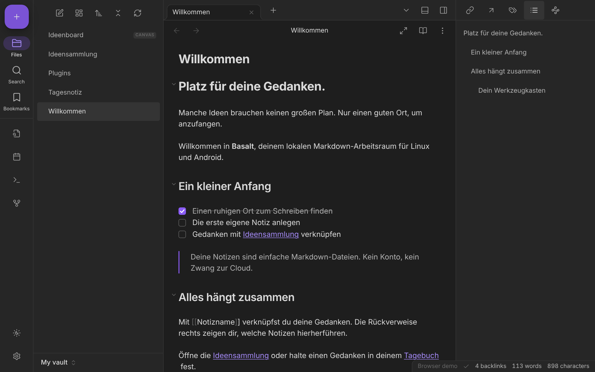

# Basalt – first look

## Desktop

## Mobile layout

## Tablet layout

The images show the **browser demo** at desktop resolution and in an emulated Android viewport:
a local Markdown workspace with file tree, tabs, live preview, reading view, wiki links and
backlinks.

More screenshots are written to `test-results/` when running `npm run test:e2e`.
