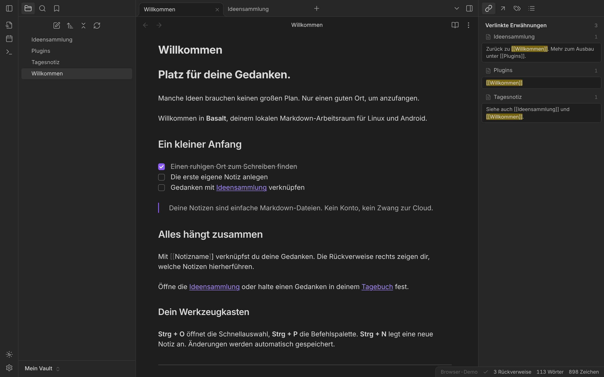
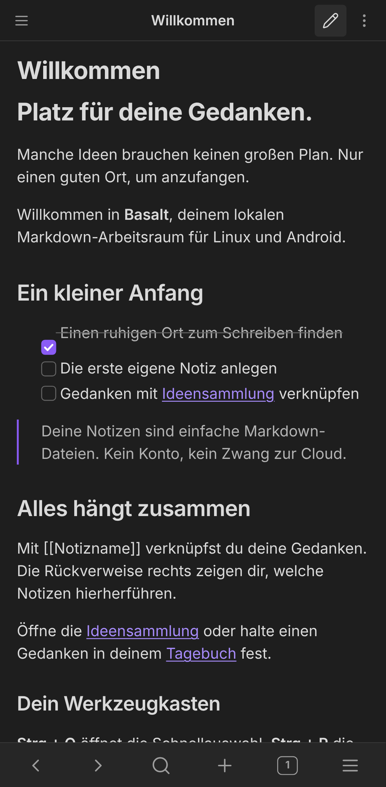

# Basalt – erste Einblicke

## Desktop

## Mobiles Layout

Beide Bilder zeigen die **Browser-Demo** in Desktop-Auflösung und einem emulierten
Android-Viewport: lokaler Markdown-Arbeitsraum mit Dateibaum, Tabs, Live-Vorschau,
Leseansicht, Wiki-Links und Rückverweisen.

Weitere Aufnahmen entstehen beim Ausführen von `npm run test:e2e` unter `test-results/`.
